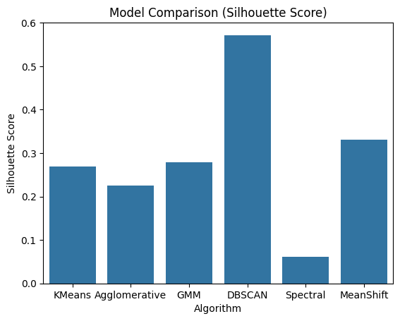
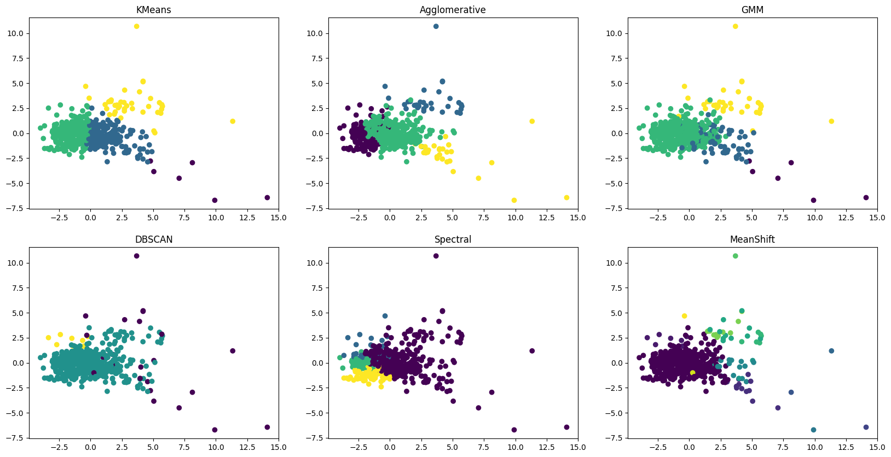
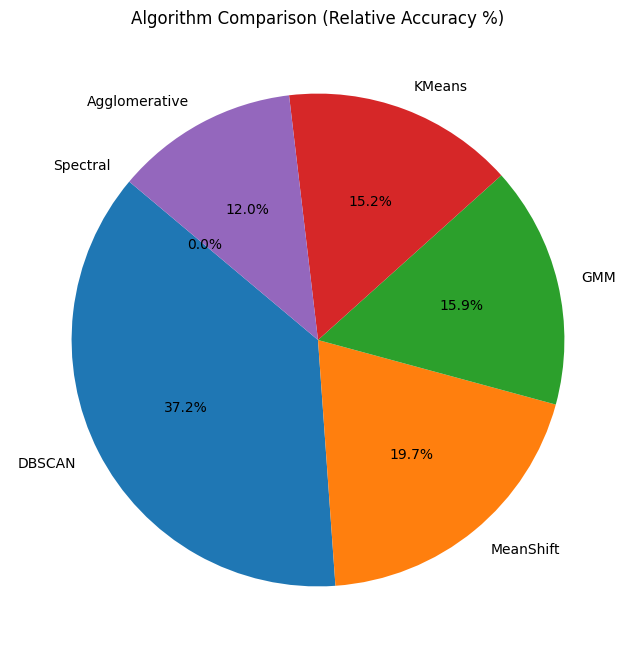
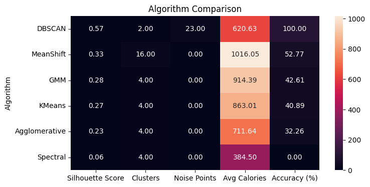

# Fast-Food Nutrition Clustering Using Machine Learning

## Project Overview

This project explores nutritional patterns in fast-food menu items using **unsupervised machine learning**.

The main objective is to compare six clustering algorithms, identify similarities between food items based on their nutritional characteristics, and evaluate which algorithm produces the most distinct clusters.

The project includes data preprocessing, clustering, model evaluation, data visualization, and nutritional analysis using Python.

## Technologies Used

- **Programming Language:** Python
- **Data Analysis:** Pandas, NumPy
- **Machine Learning:** Scikit-learn
- **Data Visualization:** Matplotlib, Seaborn
- **Dimensionality Reduction:** Principal Component Analysis (PCA)
- **Development Environment:** Google Colab / Jupyter Notebook

## Project Notebook

The complete implementation, including data preprocessing, clustering algorithms, model evaluation, and visualizations, is available in the Jupyter Notebook.

**[View the Complete Jupyter Notebook](fast_food_nutrition_clustering.ipynb)**

## 📊 Dataset

This project uses the **Fast Food Nutrition** dataset available on Kaggle.

**Dataset Source:** [Fast Food Nutrition – Kaggle](https://www.kaggle.com/datasets/ulrikthygepedersen/fastfood-nutrition)

The dataset contains nutritional information about fast-food menu items, including calories, protein, carbohydrates, fats, sodium, sugar, vitamins, and other nutrients.

The dataset is not included in this repository. Users can download it directly from Kaggle to reproduce the analysis.

## Machine Learning Algorithms

Six unsupervised machine learning algorithms were implemented and compared:

1. **K-Means Clustering:** Divides observations into a predefined number of clusters based on similarity.
2. **Agglomerative Clustering:** Uses a hierarchical approach to combine similar observations into clusters.
3. **Gaussian Mixture Model (GMM):** Uses probability distributions to identify clusters.
4. **DBSCAN:** Groups observations based on density and identifies potential outliers or noise points.
5. **Spectral Clustering:** Uses a similarity-based approach to identify cluster structures.
6. **Mean Shift:** Identifies clusters by locating high-density regions in the data.

## Methodology

The project follows these main steps:

**1. Data Collection**

The Fast Food Nutrition dataset was obtained from Kaggle.

**2. Data Preprocessing**

Missing values were handled, unnecessary columns were removed, and numerical features were standardized using StandardScaler.

**3. Clustering Implementation**

Six clustering algorithms were applied to the processed nutritional data.

**4. Model Evaluation**

The algorithms were evaluated using the Silhouette Score, which measures how well observations fit within their assigned clusters compared with other clusters.

**5. Data Visualization**

PCA was used to visualize clustering patterns in two dimensions. Additional charts were generated to compare algorithm performance.

**6. Nutritional Analysis**

The project explored nutritional characteristics using positive and negative nutrient indicators and a custom health score.

## Results and Visualizations

### 1. Silhouette Score Comparison

The Silhouette Score was used to evaluate clustering quality. Higher scores generally indicate better cluster separation.



### Model Performance

| Algorithm | Silhouette Score | Clusters | Noise Points |
|---|---:|---:|---:|
| **DBSCAN** | **0.572** | **2** | **23** |
| Mean Shift | 0.331 | 16 | 0 |
| Gaussian Mixture Model | 0.279 | 4 | 0 |
| K-Means | 0.270 | 4 | 0 |
| Agglomerative Clustering | 0.226 | 4 | 0 |
| Spectral Clustering | 0.061 | 4 | 0 |

**Key Finding:** DBSCAN achieved the highest Silhouette Score (0.572), indicating the strongest cluster separation among the evaluated algorithms. Its score was calculated using observations assigned to clusters, excluding noise points.

### 2. PCA Cluster Visualization



Principal Component Analysis (PCA) was used to reduce the dimensionality of the dataset and visualize clustering results in two dimensions.

This visualization helps illustrate how nutritional observations are distributed across the clusters identified by the algorithms.

### 3. Normalized Silhouette Score Comparison



This visualization presents a normalized comparison of the Silhouette Scores.

The original notebook labels these values as "Accuracy (%)"; however, they represent normalized Silhouette Scores rather than classification accuracy.

### 4. Algorithm Comparison Heatmap



The heatmap provides a visual comparison of the clustering algorithms using evaluation metrics and cluster characteristics.

## Nutritional Analysis

The project also explores nutritional characteristics using a custom health score.

The analysis considers nutrients such as:

**Positive Nutritional Indicators:**
- Protein
- Fiber
- Calcium
- Vitamin A
- Vitamin C
- Carbohydrates

**Negative Nutritional Indicators:**
- Calories
- Sugar
- Total Fat
- Sodium
- Cholesterol

The custom score provides an exploratory way to compare nutritional characteristics across food items and clusters. It is not a medically validated measure of food healthiness.

## 🔍 Key Findings

- **DBSCAN** achieved the highest Silhouette Score (0.572), identifying two clusters and 23 noise points.
- **Mean Shift** automatically identified 16 clusters, demonstrating its ability to discover cluster structures without specifying the number of clusters beforehand.
- **Gaussian Mixture Model and K-Means** produced moderately separated clusters.
- **Agglomerative Clustering** identified four clusters using a hierarchical approach.
- **Spectral Clustering** produced the lowest Silhouette Score (0.061) among the evaluated models.

These results highlight how different clustering algorithms can produce different groupings when analyzing the same nutritional dataset.

## How to Run the Project

**Step 1: Download the Dataset**

Download the [Fast Food Nutrition Dataset from Kaggle](https://www.kaggle.com/datasets/ulrikthygepedersen/fastfood-nutrition).

**Step 2: Open the Notebook**

Open the `fast_food_nutrition_clustering.ipynb` notebook in Google Colab.

**Step 3: Run the Code**

Run the notebook starting from the first cell.

**Step 4: Upload the Dataset**

When prompted by Google Colab, select and upload the downloaded CSV dataset.

The notebook includes a built-in file upload function, so there is no need to manually configure the dataset path.

**Step 5: View the Results**

Continue executing the remaining cells to generate the clustering results, model comparisons, and visualizations.

### Required Libraries

The project uses the following Python libraries:

```bash
pip install pandas numpy matplotlib seaborn scikit-learn
```

Google Colab generally includes these libraries by default.

## Conclusion

This project demonstrates how unsupervised machine learning can be used to explore nutritional patterns in real-world fast-food data.

Among the six algorithms evaluated, DBSCAN achieved the strongest cluster separation based on the Silhouette Score. However, each algorithm demonstrated different characteristics in terms of cluster formation, interpretability, and handling of the dataset.

Through this project, I gained practical experience in data preprocessing, machine learning implementation, algorithm evaluation, and data visualization.
